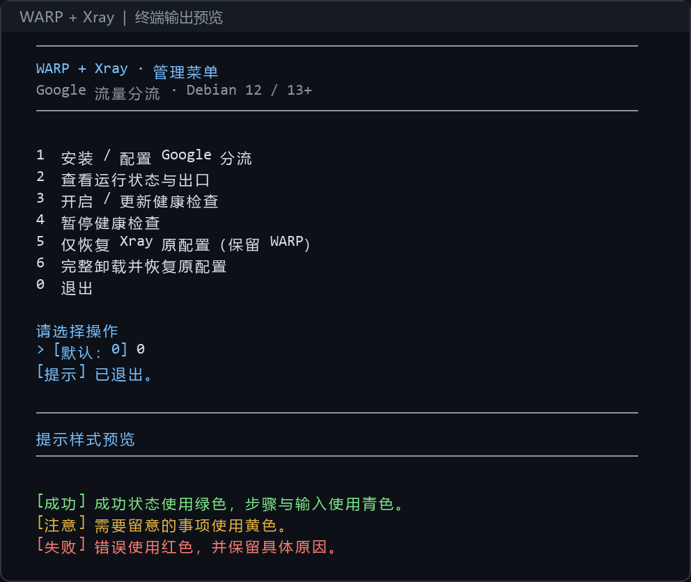

# WARP + Xray Google 分流

保留 Cloudflare WARP 官方客户端，在现有 Xray 服务端按域名分流 Google。适用于 Debian 12、13；更高版本需官方软件源支持。

```text
客户端 → VPS Xray ┬─ Google TCP → 本机 WARP SOCKS5 → Cloudflare
                 └─ 其他流量 → 原有路由
```

## 一键安装

服务器已有 curl 时执行：

```bash
curl -fsSL https://raw.githubusercontent.com/brian952700/warp-xray-debian/main/install.sh | sudo bash
```

root 用户也可以使用 `| bash`。极简系统先安装 curl：

```bash
sudo apt-get update && sudo apt-get install -y curl ca-certificates
```

如需先审阅脚本再运行：

```bash
curl -fsSL https://raw.githubusercontent.com/brian952700/warp-xray-debian/main/install.sh -o install-warp-xray.sh
less install-warp-xray.sh
sudo bash install-warp-xray.sh
```

安装器解析 main 的当前提交，从同一提交下载程序并核对 SHA256，安装到 `/usr/local/lib/warp-xray/releases/`，创建 `warp-xray` 命令。校验用于检查文件一致性，不是独立的发布签名。GitHub API 限流或网络错误会停止安装；不会自动切到不可信镜像。

只下载管理工具、不配置网络：

```bash
curl -fsSL https://raw.githubusercontent.com/brian952700/warp-xray-debian/main/install.sh | sudo bash -s -- --download-only
sudo warp-xray setup
```

## 终端交互

安装过程按步骤显示；成功、注意和错误分别用绿色、黄色和红色区分。输入项单独换行，提供默认值与示例，错误路径或序号可以重填。原始包管理输出保留，WARP 重复的裸 `Success` 输出合并为明确提示；命令失败仍显示诊断信息。

直接输入命令打开管理菜单：

```bash
sudo warp-xray
```

支持纯文本终端和日志重定向：检测不到终端、`TERM=dumb`、设置了 `NO_COLOR` 或传入 `--no-color` 时不输出 ANSI 颜色。

```bash
sudo warp-xray --no-color status
sudo env NO_COLOR=1 warp-xray
```

以下预览由程序的真实菜单输出渲染，用于展示布局和配色，不是 VPS 运行状态截图：



## 设置向导

向导会询问：

1. 是否安装/复用 WARP、接受其条款并切换到本地代理模式。
2. 是否由面板/多文件管理；这类环境只导出待合并片段，不覆盖配置。
3. 普通单文件部署的 config 绝对路径、systemd 服务名、路由插入位置。
4. 是否补充缺失的嗅探配置、应用候选配置、清理已识别旧透明代理、启用健康检查。

应用前备份并通过当前 Xray 校验；应用时重启 Xray，有短暂断连。失败则尝试恢复原配置。已被其他程序修改的配置会拒绝覆盖。保留原默认出站、非 Google 路由及现有嗅探配置。

## 管理命令

### 旧版本安装出现 90 秒超时

旧版本对 APT 也使用了 90 秒超时，生成 initramfs 等耗时操作可能被中断。
已修复：APT 不设执行超时，等待包管理锁最多 300 秒；网络探测仍有短超时。

先查看是否还有包管理进程在工作：

```bash
ps -eo pid,ppid,etime,args | grep -E '[a]pt-get|[d]pkg|[u]pdate-initramfs|[m]kinitramfs'
```

若仍在工作，等待结束；不要删除锁文件或强行结束进程。确认结束后，逐条运行，前一条成功再执行下一条：

```bash
sudo dpkg --configure -a
sudo apt-get -f install
```

完成后重新执行本页的一键安装命令，下载新版工具并继续。只运行旧的 `warp-xray setup` 不会更新本地脚本。

### 日常操作

```bash
sudo warp-xray status
sudo warp-xray
sudo warp-xray setup
sudo warp-xray enable-health
sudo warp-xray disable-health
sudo warp-xray restore --plan /var/lib/warp-xray/plan-实际编号
sudo warp-xray uninstall
```

连续三次代理连通性检查失败才恢复 warp-svc，恢复间隔至少 15 分钟；不会自动重注册、换 IP、重启 Xray 或重启服务器。健康检查运行日志：

```bash
sudo journalctl -u warp-xray-health.service -n 60 --no-pager
```

## 重复安装与完整卸载

新版 setup/prepare 会提前检测已有的 WARP 出站或路由标记，跳过重复插入，不再询问规则位置，也不覆盖原始备份。setup 可选择更新健康检查。检测到标记不代表运行中的 Xray 已加载配置，仍需业务验证。

已经安装旧版的服务器，先只更新工具，不重新配置：

```bash
curl -fsSL https://raw.githubusercontent.com/brian952700/warp-xray-debian/main/install.sh | sudo bash -s -- --download-only
```

然后完整卸载：

```bash
sudo warp-xray uninstall
```

脚本会自动查找唯一匹配的已应用备份；也可指定：

```bash
sudo warp-xray uninstall --plan /var/lib/warp-xray/plan-实际编号
```

显示原配置和备份位置后，需要输入 `UNINSTALL` 确认。顺序为：

1. 检查原备份及候选配置哈希、当前 config、实际 Xray 服务和原配置语法。
2. 将卸载前 config、原计划、相关服务与源文件备份到 `/var/backups/warp-xray/时间编号/`。
3. 恢复原始 config 并重启 Xray；原配置无法启动时换回分流配置，停止卸载，不删除 WARP。
4. 清理能识别的旧透明代理规则（可离线进行，不要求 WARP 此时连通）。
5. 停用并移除健康检查，断开并停用 WARP，用 APT purge 移除 `cloudflare-warp`。
6. 删除固定的 WARP 源/密钥、本地 WARP 注册/配置/日志目录、工具命令、工具版本及活动状态目录。

**保留 Xray、共享依赖、卸载归档和系统 journal。** 不执行 autoremove，不重启服务器。旧 redsocks 可能被其他服务使用，不会全局结束或卸载；这也不是清除一切历史痕迹的功能。

没有可验证的备份、备份损坏、当前 config 有后续修改、另一个已跟踪配置仍依赖 WARP、遇到未知旧规则或共享密钥等情况，会停止并给出提示，不盲目覆盖或卸载。面板/多文件导出模式没有可自动恢复的单文件计划，需先在面板恢复配置，不能用此功能绕过面板。

APT purge 等后续步骤失败时，原始 config 可能已恢复，但管理工具和计划仍保留，可修复错误后重试；卸载归档中的 `uninstall.json` 记录已完成阶段。完整卸载会影响这台服务器其他使用 WARP 的程序，执行前确认用途。

## 使用边界

- 仅处理通过 Xray 的流量，客户端原有连接参数通常不用改。
- 默认覆盖常见 Google/YouTube 域名，不保证全部产品和地区域名；可自定义清单。
- 匹配到的 UDP 会拒绝，不假设 WARP 本地 SOCKS 支持 UDP。浏览器通常可回退 TCP，需要 UDP 的应用可能失败。
- 不关闭 IPv6，不添加黑洞路由；完整双栈能力需实际检测。
- 纯 IP、ECH 或无法嗅探的请求可能漏匹配。Google 出口地区、验证码与可用性不作保证。
- 不擅自清空共享防火墙，不卸载可能被其他应用使用的 redsocks；持久化旧规则需另行检查。
- 有面板时必须通过面板保存出站/路由，避免面板覆盖文件。
- 仓库的自动化测试不等于真实 VPS 验证；首次部署请保留 SSH，并从客户端测试业务。

[完整操作与迁移说明](GUIDE.zh-CN.md) · [验证范围](VALIDATION.txt)
